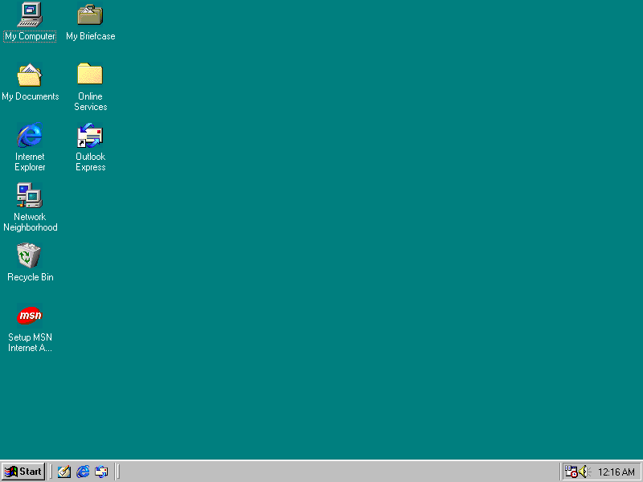
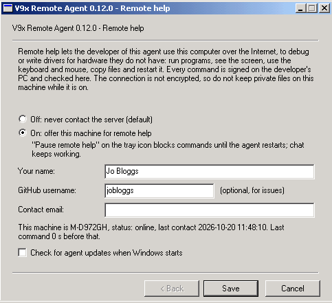
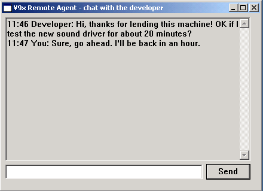
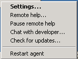
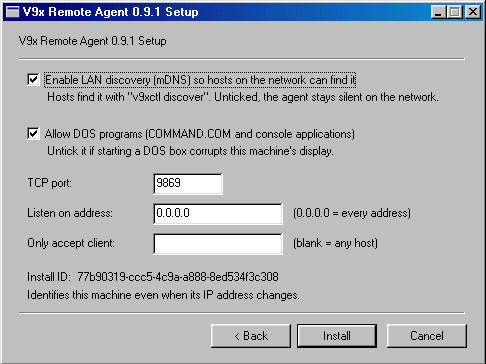
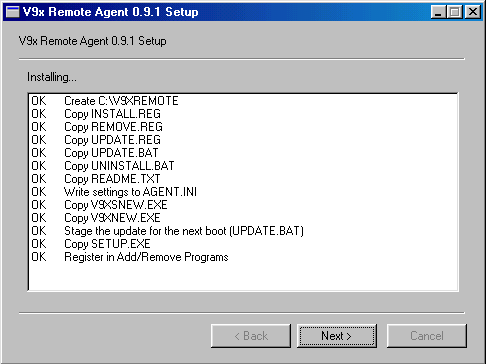
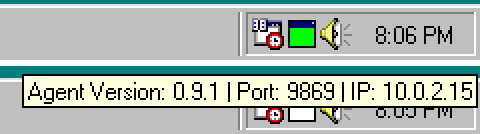

# V9x Remote Agent

Remote control for Windows 9x development guests, built for AI-driven
development and debugging. A small (about 500 KB) runtime-free agent runs
inside Windows 95/98/Me or Windows 2000 (typically an 86Box VM, or real
retro hardware), and a cut-down build runs under DOS. A PowerShell CLI and
an MCP server on the
host let a developer, or an AI coding agent working on their behalf, build
software on a modern machine, push it into the guest, run it, capture output
and screenshots, and run a verified reboot workflow with reconnect, persisted
resume-token, and desktop-readiness checks.



*The screenshot above was taken by the agent itself:
`v9xctl.ps1 screenshot -Destination desktop.bmp`.*

> **Have hardware the drivers don't support yet, or a bug only your machine
> shows?** You can lend that machine to the developer over the Internet,
> safely and only while you choose: see
> [Request remote support](#request-remote-support).

## Why

Retro Windows development has a brutal inner loop: build on a modern host,
copy into the VM by hand, click around, squint at the screen, reboot, repeat.
This project turns that into one bounded command per step, with JSON output
and deterministic exit codes, which is exactly the interface an AI coding
agent needs. Point Claude Code (or any MCP client) at a Windows 98 VM and it
can compile, deploy, execute, read stdout, look at the screen, and prove a
clean reboot without a human touching the emulator.

## What it does

- Direct Win32 and `COMMAND.COM` shell execution with streamed stdout/stderr,
  byte limits, timeouts, cancellation, and deterministic exit codes
- CRC32-verified transactional file upload/download (`.PART` staging plus
  rollback backups) and recursive host-to-guest tree push
- Verified reboot workflow: require disconnect/reconnect, the exact persisted
  resume token, a changed agent-start counter, and desktop readiness. The
  counter alone is not machine-reboot proof.
- `reset` for Windows 9x machines whose restart hangs in real mode (a
  resident NDIS2 network stack, for one): flushes the registry and disks,
  then resets the hardware through port CF9h, with the same proof as reboot
- Desktop-ready polling and 24-bit BMP screenshot capture
- Mouse and keyboard injection (move, click, drag, wheel, hotkeys, typed text,
  relative motion for games) so an agent can drive dialogs and installers the
  UI only exposes visually
- Optional live remote control for a person: `V9XVNC.EXE`, a small VNC (RFB)
  server, off unless enabled in SETUP.EXE, so any VNC viewer can watch the
  screen and drive the keyboard and mouse. On Windows 2000 it runs as a
  service and follows the Winlogon desktop, so the lock and logon screens are
  visible too ([docs/guest-agent.md](docs/guest-agent.md))
- Hardware and OS inventory in one call: OS build, CPU, memory, drives,
  active display adapter and mode, IPs, BIOS, and loaded PnP devices
- Agent upgrades from the host with `v9xctl update`: a hot swap with no
  reboot on 0.6.0 and later, and a scripted one-reboot staged route for
  older agents
- Guest-side HTTP download (up to 2 GiB, CRC32-verified) for payloads too
  big to push
- Optional LAN discovery over standard mDNS/DNS-SD, plus a per-machine
  install ID so `v9xctl -Id <id>` finds a guest again after its address
  changes
- A graphical `SETUP.EXE` installer and a notification-area icon that shows
  the agent is running and flashes green while a host is talking to it
- A small, versioned, fragmentation-safe TCP protocol (see
  [docs/protocol.md](docs/protocol.md)); the guest uses a small network agent
  plus a disposable screenshot helper, with audited imports and no runtime
  dependencies
- Optional IPv4 binding, port, and client allowlist for real retro hardware
  on an isolated network ([docs/physical-machine.md](docs/physical-machine.md))
- Idle connections are dropped after `idle_timeout` seconds (default 300), so
  a host that vanished without closing its socket no longer holds a slot
- Self-repair of an `AGENT.INI` saved with LF-only line ends, and a `put`
  warning when an `.INI`, `.BAT`, `.REG` or similar Windows text file is sent
  with LF-only line ends
- Opt-in remote help (0.12.0+): an owner can lend a real machine to the
  developer over the Internet, with every command signed on the developer's
  PC and checked by the agent, a Pause switch in the tray and a chat window
  ([Request remote support](#request-remote-support))
- Self-update from the tray: "Check for updates..." downloads, verifies
  (Ed25519-signed release, SHA-256) and installs a newer agent

## Request remote support

Windows 9x drivers are written against real hardware, and there is far more
of it than any one developer owns. If you have a machine with a graphics,
sound or network card that the Velocity9x drivers do not support yet, or a
problem that only shows up on your hardware, you can lend that machine to
the developer for a while. They then work on it directly, as if it were on
their desk, and you stay in control the whole time.

**What you need:** the machine running Windows 95, 98, Me or 2000 with an
Internet connection, and the V9x Remote Agent 0.12.0 or later.

1. **Install the agent.** Download `V9XREMOTE.ISO` or
   `v9x-remote-agent-<version>-win32.zip` from the
   [latest release](../../releases/latest), copy the files to the machine and
   run `SETUP.EXE`. An icon appears next to the clock. (Already have an older
   agent? Right-click the icon and choose **Check for updates...**.)
2. **Turn on remote help.** Right-click the icon and choose **Remote
   help...**. Read what it allows, choose **On**, enter your name and, if you
   have one, your GitHub username, then click **Save**. The agent restarts
   and the page now shows this machine's id, such as `M-4F7K2Q`.
3. **Ask for help.** [Open an issue](../../issues/new) with:
   - the machine id from the Remote help page;
   - the hardware involved (card make and model, or the PCI ID from Device
     Manager) and what goes wrong;
   - roughly when the machine can be left on.

   If you can, leave the machine on and online for at least 48 hours after
   opening the issue. The developer may be in a different time zone, and
   driver work often needs several sessions with rebuilds in between. You
   can keep using the machine meanwhile; just pause remote help (step 5)
   whenever you need it to yourself.
4. **Talk it through.** The developer will say hello in the agent's chat
   window before starting, which pops up on your screen by itself. You can
   reply there at any time, or open it from the icon (**Chat with
   developer...**).
5. **Stop whenever you like.** **Pause remote help** on the icon's menu blocks
   all commands at once (chat keeps working) until you choose **Resume** or
   the agent restarts. To end it for good, open **Remote help...** again and
   choose **Off**.

| The Remote help page | Chat with the developer | The tray menu |
|---|---|---|
|  |  |  |

**What lending allows, and what protects you:**

- While remote help is on and not paused, the developer can run programs,
  see the screen, use the keyboard and mouse, copy files and restart the
  machine. That is what driver work needs.
- Every command is signed with a key that exists only on the developer's own
  PC, and the agent checks the signature before acting on it. Neither the
  update server nor anyone between you and it can make the machine do
  anything.
- The connection is plain HTTP (Windows 9x has no usable encryption), so
  someone on the network path could watch a session. Do not keep private
  files on a machine while you lend it.
- The tray icon tells you when the machine was last used: its tooltip reads
  "In use: last command ... ago" for a minute after each command.
- Remote help is off by default and does nothing until you turn it on. Off
  means the agent never contacts the server for it.

The details, for the curious: [docs/remote-help.md](docs/remote-help.md).

## Supported guests

| Guest | Agent | Notes |
|---|---|---|
| Windows 95, 98, 98 SE, Me | `V9XAGNT.EXE` | The primary target. Starts from `RunServices` before anyone logs on. Every verb, including `reset`. |
| Windows 2000 | `V9XAGNT.EXE` (same binary) | Since 0.9.0. Starts from `HKLM\...\Run` at logon, so pair it with autologon. Install with `SETUP.EXE` as an administrator. `shell` runs `CMD.EXE /C`; reboot and shutdown take `SeShutdownPrivilege`; `inventory` reads the NT registry and Configuration Manager. `reset` is Windows 9x only. |
| DOS | `V9XAGNT.EXE` (separate DOS/4GW build) | Exec and file transfer only; see below. |

The Windows 9x and Windows 2000 agent is one executable with one audited
import table: every difference is chosen at run time from `GetVersion()`,
and the NT-only calls are resolved with `GetProcAddress`. Windows NT 4.0 and
Windows XP are untested.

## DOS build

A cut-down agent for real-mode DOS boxes (DOS/4GW protected mode, Watt-32 for
TCP/IP) speaks the same wire protocol, so the same `v9xctl.ps1` and MCP tooling
drive it. It keeps command execution and CRC-verified file transfer plus the
HELLO/PING/INFO handshake; the Win32-only extras (screenshot, input, power,
hot-update, HTTP download) and live exec streaming/cancel/timeout are dropped.
Build with `scripts\build-guest-dos.ps1`; see [docs/dos-agent.md](docs/dos-agent.md).

## Quickstart

| You have | Start here |
|---|---|
| Nothing set up yet | [docs/quickstart-86box.md](docs/quickstart-86box.md): 86Box + your own Windows 98 media + the install ISO |
| A working Win98 or Win2000 VM in 86Box | Three steps below |
| An AI coding agent to hook up | [AGENTS.md](AGENTS.md) and [mcp/README.md](mcp/README.md) |
| Open Watcom and curiosity | The Build section below |

### I already have a Windows 98 or Windows 2000 VM

1. Give the VM an NE2000 PnP NIC on SLiRP and forward TCP 9869, by adding to
   the profile's `86box.cfg` (while 86Box is closed):

   ```ini
   [Network]
   net_01_card = ne2kpnp
   net_01_net_type = slirp

   [SLiRP Port Forwarding #1]
   0_protocol = tcp
   0_external = 9869
   0_internal = 9869
   ```

2. Get `V9XREMOTE.ISO` (from the release download, or build it yourself with
   `.\scripts\make-install-media.ps1`), attach it as a CD image in 86Box,
   then in the guest run `D:\SETUP.EXE` (AutoPlay starts it) and let it
   restart Windows. `D:\INSTALL.BAT` does the same without a window
   (Windows 9x only; on Windows 2000 use `SETUP.EXE` as an administrator,
   and turn on autologon, because there the agent starts at logon).

3. From the host:

   ```powershell
   .\scripts\v9xctl.ps1 ping
   ```

   `{"Success":true,...}` means an AI agent can now drive the guest. Read
   [docs/ai-workflows.md](docs/ai-workflows.md) for the full loop.

### What the guest side looks like

`SETUP.EXE` asks for the few settings that matter, shows the machine's
install ID, and logs each step. Over an existing install it keeps the
settings and ID and stages the new version for the next restart; run again
from `C:\V9XREMOTE` it only changes settings. `SETUP.EXE /S` installs
silently and `SETUP.EXE /uninstall` removes the autostart.

| Settings | Install |
|---|---|
|  |  |

Once installed, the agent starts with Windows before anyone logs on and puts
an icon in the notification area. Its body flashes green while a host is
connected or a program it started is running, and its tooltip gives the agent
version, port, and IP address:



Right-click the icon for **Settings...** (or double-click it) to change the
same options as setup: LAN discovery, DOS programs, port, listen address,
allowed client and VNC. Saving restarts the agent so they apply at once, with
no reboot. **Restart agent** on the same menu just restarts it.

*All three were captured by the agent itself (`v9xctl screenshot`), with
`v9xctl input` clicking through the wizard.*

## Host requirements

- The PowerShell CLI (`scripts\v9xctl.ps1`) needs Windows PowerShell 5.1, so
  a Windows host.
- The MCP server (`mcp\v9x_mcp.py`) needs only Python 3.9+ and works on
  Windows, macOS, and Linux; 86Box runs on all three.
- Building the guest agent from source needs Open Watcom (see Build below);
  release downloads include a prebuilt, import-audited `V9XAGNT.EXE` so most
  users never need a compiler.

## Host usage

```powershell
.\scripts\v9xctl.ps1 ping
.\scripts\v9xctl.ps1 info -Json
.\scripts\v9xctl.ps1 shell -Command "VER"
.\scripts\v9xctl.ps1 exec -Application C:\V9XREMOTE\TEST.EXE -Arguments "/quiet" -WorkingDirectory C:\V9XREMOTE
.\scripts\v9xctl.ps1 stat -Path C:\V9XREMOTE -Json
.\scripts\v9xctl.ps1 mkdir -Path C:\V9XREMOTE\JOBS\demo
.\scripts\v9xctl.ps1 put -Source .\TEST.EXE -Destination C:\V9XREMOTE\JOBS\demo\TEST.EXE
.\scripts\v9xctl.ps1 get -Source C:\V9XREMOTE\AGENT.LOG -Destination .\agent.log
.\scripts\v9xctl.ps1 push-tree -Source .\package -Destination C:\V9XREMOTE\JOBS\demo
.\scripts\v9xctl.ps1 reboot -JobId demo-reboot -WaitSeconds 180 -Json
.\scripts\v9xctl.ps1 reset -JobId demo-reset -WaitSeconds 180 -Json
.\scripts\v9xctl.ps1 wait-desktop -WaitSeconds 120
.\scripts\v9xctl.ps1 screenshot -Destination .\desktop.bmp -Json
.\scripts\v9xctl.ps1 input -Sequence "move 80,486; click left; type notepad; key ENTER"
.\scripts\v9xctl.ps1 inventory -Json
.\scripts\v9xctl.ps1 download -Url http://10.0.2.2:8000/big.zip -Destination C:\V9XREMOTE\JOBS\big.zip
.\scripts\v9xctl.ps1 update -Source .\build\install -WaitSeconds 300 -Json
.\scripts\v9xctl.ps1 discover
```

Exit code 0 means success. Transport and protocol failures use 20 to 23;
process creation, unexpected exit, timeout, and cancellation use 30 to 33.
The full verb and exit-code reference is [docs/host-cli.md](docs/host-cli.md).

Two host-side helpers sit alongside `v9xctl`:

```powershell
.\scripts\set-autologon.ps1                     # is this guest going to stop at a logon prompt?
.\scripts\set-autologon.ps1 -Dismiss            # clear a logon dialog that is up right now
.\scripts\capture-emulator-window.ps1 MyVm -OutFile .\screen.png
```

A guest that prompts at boot is the one trap worth knowing about up front. The
agent itself runs and answers before anyone logs on, but `screenshot` and
`wait-desktop` need Explorer, so an unattended run stalls at its first
`wait-desktop` while `ping` keeps succeeding. `set-autologon.ps1` reports and
fixes that; `capture-emulator-window.ps1` lets you see a screen the in-guest
capture path cannot reach. `set-autologon.ps1` handles the Windows 9x rules
only. A Windows 2000 guest needs autologon for a different reason (the agent
itself does not start until someone logs on); set it with the usual
`Winlogon` `AutoAdminLogon`, `DefaultUserName` and `DefaultPassword` values.

## Build

Only needed if you want to modify the guest agent; releases ship a prebuilt
package. Open Watcom must be available through `WATCOM` or at `C:\WATCOM`
(64-bit host tools, `binnt64`).

```powershell
.\scripts\build-guest.ps1 -BuildId dev-001
.\scripts\build-host-tests.ps1
.\scripts\make-install-media.ps1 -Validate
```

The guest package is written to `build\install`, which always holds the most
recently built version, and the install CD image to `build\V9XREMOTE.ISO`.
The build audits the produced PE (allowed DLLs, required imports, subsystem
4.0) and stamps the package version from
[include/v9xremote/version.h](include/v9xremote/version.h).

For a physical Windows 9x machine, use the same package and configure
`C:\V9XREMOTE\AGENT.INI` as described in
[docs/physical-machine.md](docs/physical-machine.md).

## Safety

Protocol v1 is intentionally unauthenticated: anyone who can reach TCP 9869
has full control of the guest. Keep 86Box in SLiRP/NAT mode, protect the
forwarded port with the host firewall, and never bridge the guest NIC or
expose the listener to a LAN or the Internet. LAN discovery (`discovery=1`)
advertises the agent to every host on its segment, so enable it only on an
isolated development network. Details in [SECURITY.md](SECURITY.md).

## Documentation

- [docs/quickstart-86box.md](docs/quickstart-86box.md): zero-to-working 86Box setup
- [docs/ai-workflows.md](docs/ai-workflows.md): the AI development loop, annotated
- [AGENTS.md](AGENTS.md): operating manual for AI coding agents
- [mcp/README.md](mcp/README.md): MCP server setup and tool reference
- [docs/host-cli.md](docs/host-cli.md): every v9xctl verb and exit code
- [docs/guest-agent.md](docs/guest-agent.md): guest runtime behaviour and AGENT.INI
- [docs/protocol.md](docs/protocol.md): the wire protocol
- [docs/physical-machine.md](docs/physical-machine.md): real retro hardware
- [docs/dos-agent.md](docs/dos-agent.md): the DOS build
- [docs/remote-help.md](docs/remote-help.md): self-update and opt-in remote
  help (lending a machine to the developer over the Internet)
- [docs/design.md](docs/design.md): the original staged design document
- [CHANGELOG.md](CHANGELOG.md)

Working notes, newest first:

- [docs/decisions/2026-10-20-remote-help-relay.md](docs/decisions/2026-10-20-remote-help-relay.md):
  remote help as an opaque byte relay through the update server, with every
  command chunk Ed25519-signed on the developer's PC; why not server-side
  verbs or a plain machine secret
- [docs/decisions/2026-10-15-vnc-remote-control.md](docs/decisions/2026-10-15-vnc-remote-control.md):
  live remote control through `V9XVNC.EXE`, a separate RFB (VNC) server
  helper, instead of an off-the-shelf server or a v9x-protocol stream; the
  phased plan and the phase 1 test results
- [docs/issues/2026-10-12-install-id-changes-every-boot.md](docs/issues/2026-10-12-install-id-changes-every-boot.md):
  an LF-only `AGENT.INI` made Windows 9x append a new `install_id` on every
  start; the 0.10.0 repair and the cleanup for an affected machine.
- [docs/decisions/2026-10-12-reset-without-real-mode.md](docs/decisions/2026-10-12-reset-without-real-mode.md):
  the `reset` verb: ring-3 port access to CF9h, the volume-lock flush, and why
  it uses CF9h's full reset with no fallback.
- [docs/decisions/2026-10-01-mdns-discovery-and-install-id.md](docs/decisions/2026-10-01-mdns-discovery-and-install-id.md):
  SETUP.EXE, LAN discovery over standard mDNS/DNS-SD, and the install ID that
  identifies a machine across address changes
- [docs/decisions/2026-09-25-no-dos-vm-guests.md](docs/decisions/2026-09-25-no-dos-vm-guests.md):
  `allow_dos_vm=0` and the native hot swap, for guests whose display driver
  corrupts the screen when a DOS VM starts
- [docs/decisions/2026-09-24-tray-activity-icon-without-gdi.md](docs/decisions/2026-09-24-tray-activity-icon-without-gdi.md):
  how the tray icon flashes green during activity when the agent may not
  import GDI32
- [docs/decisions/2026-09-04-prelogon-reachability-and-autologon.md](docs/decisions/2026-09-04-prelogon-reachability-and-autologon.md):
  what the agent can and cannot do before anyone logs on, and the Windows 9x
  autologon rules behind `scripts\set-autologon.ps1`
- [docs/decisions/2026-09-04-tray-icon-createthread-lpthreadid.md](docs/decisions/2026-09-04-tray-icon-createthread-lpthreadid.md):
  why the notification-area icon never appeared before 0.6.2

## Windows licensing

This project contains and distributes no Microsoft software. You must supply
your own Windows 95/98/Me or Windows 2000 installation media and license for
the guest.

## License

BSD 2-Clause. See [LICENSE](LICENSE).
